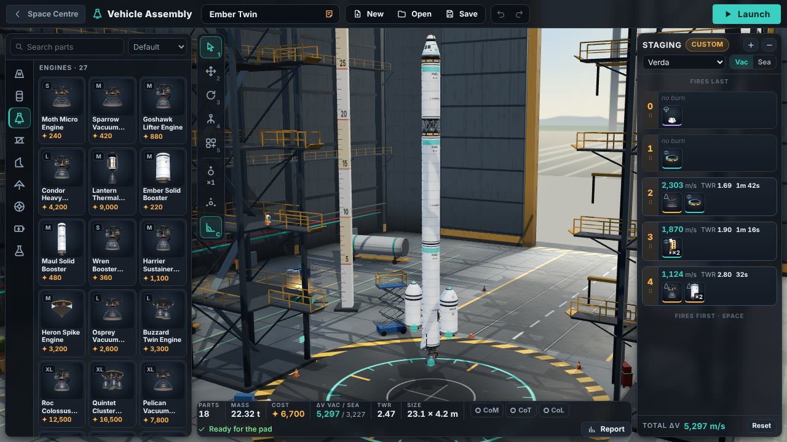
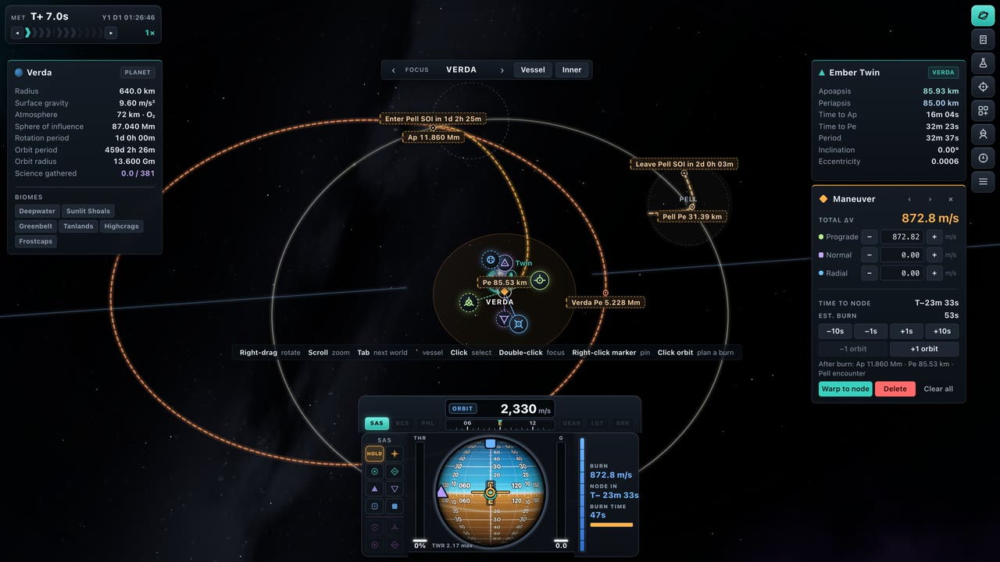
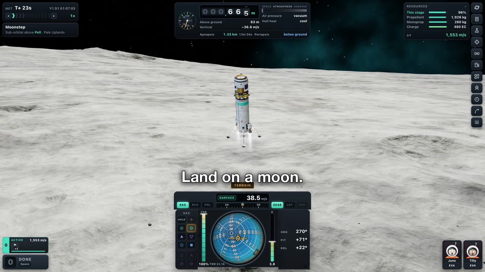
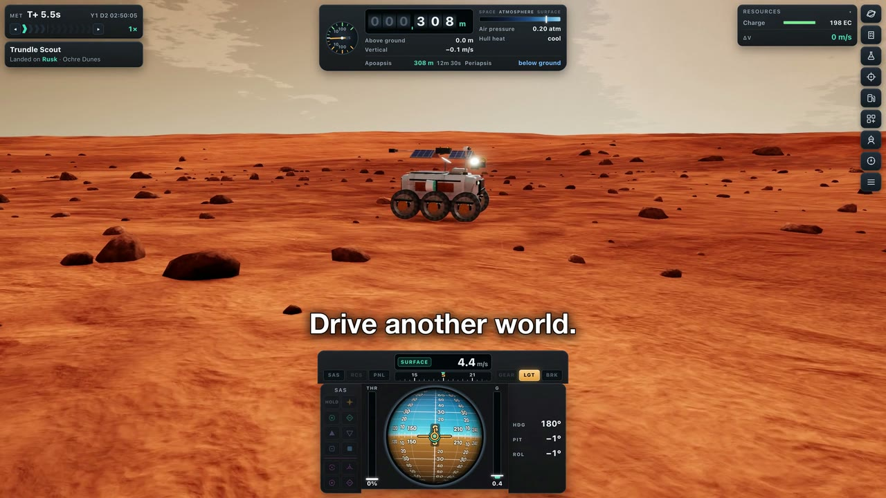
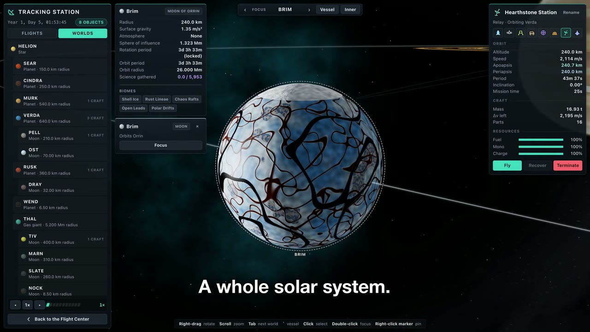
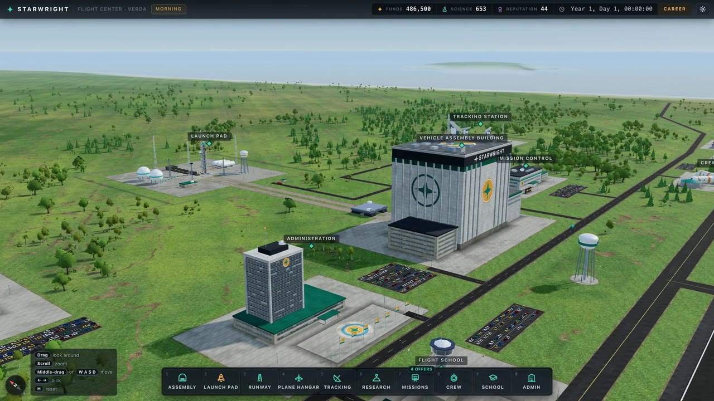
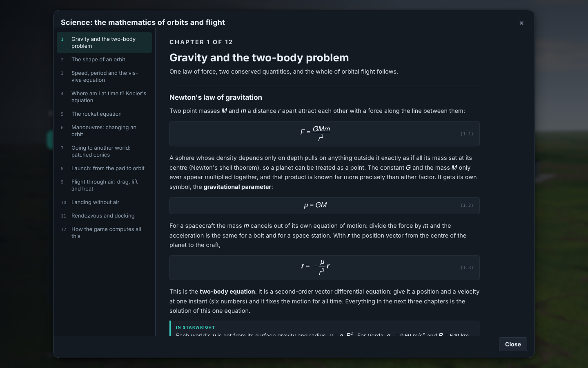

<h1 align="center">Starwright</h1>

<p align="center"><b>Build it. Launch it. Bring the Pips home.</b></p>

<h3 align="center">Made for people who love Kerbal Space Program and SpaceX.</h3>

<p align="center">
A full 3D rocket-building and orbital-flight game that runs in your browser.<br>
Real orbital mechanics. A solar system of nineteen bodies. No account, no download store, no cost.
</p>

<p align="center"><b>Built with AI, and said plainly:</b> directed by one person, written by 20+ Claude AI agents and independently reviewed by Grok AI agents. <a href="#how-it-was-built">How it was built</a>.</p>

<p align="center"><sub>An independent, original game. Not affiliated with or endorsed by the makers of Kerbal Space Program or by SpaceX.</sub></p>

<!--
  TRAILER. The animated preview below links to the 60-second trailer in media/.
  To get a real inline video player here on github.com: edit this file on github.com, drag
  media/starwright-trailer.mp4 into the editor, and put the link GitHub gives you on its own
  line in place of the <p> block below. The file is under GitHub's 10 MB limit for that.
-->
<p align="center">
  <a href="media/starwright-trailer.mp4">
    
  </a>
  <br>
  <a href="media/starwright-trailer.mp4"><b>▶ Watch the 60-second trailer (with sound)</b></a>
</p>

<p align="center">
  <a href="#play-in-one-step"><b>Play</b></a> ·
  <a href="#your-first-orbit">First orbit</a> ·
  <a href="#for-the-people-who-do-the-math">The physics</a> ·
  <a href="docs/MANUAL.md">Manual</a> ·
  <a href="#roadmap">Roadmap</a> ·
  <a href="#come-build-it-with-us"><b>Volunteer</b></a>
</p>

---

Nobody handed you a rocket. You bolt one together in the assembly building, part by part and
stage by stage. You roll it to the pad, light it, and find out. If the staging is wrong it comes
apart at two kilometres. If it is right, you tip east over the coast, the sky goes black, and
there is a planet under you and a map full of orbits to plan.

**Starwright is for KSP lovers and SpaceX lovers.** If you ever lost a weekend to Kerbal Space
Program, or you never miss a launch and watch booster landings with a spreadsheet open, this
game was made for you. It is an original game in that tradition, with its own worlds, its own
crew and its own art, built so that anyone can open it and fly.

## Why this exists

We all loved Kerbal Space Program. We all played it, and it was awesome. It taught a generation
what an orbit really is, why you burn sideways to stay up, and how good it feels when a rocket
you built yourself finally makes it.

Then we waited for version 2. It kind of came out: it reached early access in 2023, and the
year after, the studio building it was closed and the updates stopped.

Starwright is not going to bring KSP back, and it is not trying to replace it. But it might be a
way to enjoy some of that same excitement of spaceflight and orbital dynamics, in a game that
you own. It is open source, it runs on your own machine, and nobody can switch it off.

To the people who made KSP: thank you. This exists because of what you started.

## How it was built

Starwright was not written by hand, and it would be wrong to let anyone think so.

It is the result of an extensive collaboration between one person and teams of AI agents. Jerry
Smith directed the project: what to build, what it should feel like, what was not good enough,
and when it was ready. More than 20 Claude agents, working in parallel teams, wrote most of the code, the
tests, the physics checks and these documents. A separate team of Grok agents, run by Jerry
independently of the Claude agents, reviewed the work. Every build was played and judged by a
human, and sent back when it fell short.

If you are curious what a person and a group of AI agents can build together, this repository is
one honest answer, and the full source is here to read.

"Teams" means teams of AI agents. Nobody at Anthropic or xAI, the companies that make Claude and
Grok, worked on Starwright, and it is not affiliated with or endorsed by either of them.

## What you get

| | |
|---|---|
| [](media/shot-assembly.jpg) | [](media/shot-launch.jpg) |
| **Build anything.** 186 parts: capsules and probe cores, liquid, solid, jet, ion and nuclear engines, wings, wheels, docking rings, science gear. Symmetry, staging and a live delta-v budget for every stage. | **Fly it yourself.** Staging, a gravity turn through real drag and heating, a navball and a flight computer that helps when you ask and stays out of the way when you do not. |
| [](media/shot-map.jpg) | [](media/shot-moon.jpg) |
| **Plan the burn.** Drop a maneuver node on your orbit, drag the handles, and watch the encounter appear before you spend a drop of fuel. Time warp to 100,000×. | **Land on a moon.** Then step outside, plant a flag, take a sample and get everyone home through re-entry. |
| [](media/shot-rover.jpg) | [](media/shot-system.jpg) |
| **Not only rockets.** Rovers, spaceplanes off a runway, space stations assembled by docking, fuel pumped from tanker to ship. | **A whole solar system.** A star, eight planets, nine moons and a comet, each with its own terrain, gravity and sky. |

And around the flying:

- **Career, Science and Sandbox modes.** Funds, science and reputation, a 27-node tech tree, a
  contract board, and a crew of Pips who gain experience.
- **A flight program of 71 missions** from a first hop to the far edge of the system, so there
  is always a next goal.
- **15 ready-made scenarios.** Skip to the good part: already in orbit, 120 metres from a
  station, on final descent to a moon, or falling from 120 km in a bare capsule.
- **Flight School.** Eight illustrated lessons from a first hop to rendezvous, most with a
  **Try it** button.
- **Rockets that bend and break.** Every joint between two parts carries a computed load. Tall
  thin stacks wobble, and a hard turn in thick air snaps them. A read-out and a stress overlay
  (the `;` key) show the load in flight, and the assembly building tells you which joint will
  give way before you launch (the `L` key). Wider parts, shorter stacks and brace struts are the
  cure. A switch in Settings turns the breaking off.
- **Rockets that come apart in the air.** Flip or tumble in thick air and the side boosters are
  ripped from their clamps, antennas and open solar panels are stripped, nose cones go, and
  the pieces fly on as debris. A clean climb loses nothing.
- **Landing legs with real suspension** that compress and settle on touchdown.
- **A self-running demo tour** if you just want to watch the game fly itself for six minutes.

<p align="center">
  
</p>

## Play in one step

**Easiest of all: play in your browser.** Nothing to install.

### ▶ [Play Starwright now](https://jsmith0475.github.io/Starwright/)

Prefer your own copy that works offline? One step puts Starwright on your machine and starts it.

### macOS

Open **Terminal** (press `Cmd`+`Space`, type *Terminal*, press `Return`), paste this, press
`Return`:

```sh
curl -fsSL https://raw.githubusercontent.com/jsmith0475/Starwright/main/install.sh | sh
```

### Windows 10 and 11

Open **PowerShell** (press the `Windows` key, type *PowerShell*, press `Enter`), paste this,
press `Enter`:

```powershell
irm https://raw.githubusercontent.com/jsmith0475/Starwright/main/install.ps1 | iex
```

### Linux

In a terminal:

```sh
curl -fsSL https://raw.githubusercontent.com/jsmith0475/Starwright/main/install.sh | sh
```

### What that one step does

1. Downloads the game into a `Starwright` folder in your home folder.
2. Adds a **Starwright** shortcut (Desktop on macOS and Windows, applications menu on Linux).
3. Starts the game. A small window opens saying *Starwright is running*, and your browser opens
   on the title screen.

After that, double-click the shortcut whenever you want to play. Leave the small window open
while you play and close it when you are done.

Nothing is installed system-wide, nothing asks for a password, and the game never touches the
network once it is on your machine. To update, run the same line again. Your saved games live
in the browser and are kept. To uninstall, delete the `Starwright` folder and the shortcut.

<details>
<summary><b>Rather not paste a command? Download and double-click instead.</b></summary>

1. Click the green **Code** button at the top of this page, then **Download ZIP**.
2. Unzip it anywhere.
3. Double-click the launcher for your system:

| System | Double-click | The first time |
|---|---|---|
| macOS | `start.command` | macOS may say the file is from an unidentified developer. Right-click it, choose **Open**, then **Open**. |
| Windows | `start.bat` | Windows may show *Windows protected your PC*. Click **More info**, then **Run anyway**. |
| Linux | run `./start.sh` in a terminal | |

Your browser opens at <http://localhost:8642/>.

</details>

<details>
<summary><b>Something not working?</b></summary>

- **The game has to be served, not opened.** Double-clicking `index.html` shows a blank page,
  because browsers do not load JavaScript modules from a file. Use the launcher.
- **macOS or Linux says Python is missing.** The launcher uses Python 3 to serve the game. On
  a Mac, run `xcode-select --install` once in Terminal. On Linux, install `python3` from your
  package manager. Node.js works too if you have it.
- **Port 8642 is in use.** Start on another port: `STARWRIGHT_PORT=8700 ./start.sh`, or
  `start.bat -Port 8700` on Windows. Saves are tied to the port, so pick one and keep it.
- **Blank or slow picture.** Starwright needs WebGL 2 and a reasonably recent graphics card.
  Use a current Chrome or Edge, and turn the quality down in **Settings**.
- **Still stuck?** [Open an issue](../../issues/new/choose) and say what system and browser
  you are on. That report is a real contribution.

</details>

## Your first orbit

Starwright is played with a keyboard and a mouse with a wheel.

1. On the title screen choose **Scenarios**, then **First Orbit**. A finished rocket is waiting
   in the assembly building. Press **Launch**.
2. Press `Z` for full throttle and `Space` to light the engine.
3. At about 1 km, tip east with `D`. Aim for roughly 45° by 10 km and nearly flat by 40 km.
4. Press `Space` again each time a stage runs dry.
5. Open the map with `M`. Burn until the high point of your path (the apoapsis) is about 80 km,
   then cut the engine with `X`.
6. Click your orbit near the apoapsis to add a maneuver node. Drag the prograde handle until the
   low point is above 72 km, the top of the atmosphere. Burn at the node.

You are in orbit. Everything else in the game is a variation on what you just did.

| Keys | |
|---|---|
| `W` `A` `S` `D` `Q` `E` | Pitch, yaw, roll |
| `Shift` / `Ctrl` | Throttle up / down (`Z` full, `X` cut) |
| `Space` | Launch, next stage |
| `T` / `R` | SAS / RCS |
| `M` | Map and maneuver nodes |
| `.` / `,` | Time warp faster / slower |
| `F5` / `F9` | Quicksave / quickload |

The [player's manual](docs/MANUAL.md) has every key, rendezvous and docking step by step, fuel
transfer, career mode and contracts.

## For the people who do the math

Starwright does not fake its orbits, and it shows its work.

- **The model.** Patched conics with bodies on rails and Laplace spheres of influence: the model
  genre veterans already know how to fly. Coasting and time warp use the exact Kepler solution,
  so an orbit does not drift at any warp rate. Powered and atmospheric flight is integrated
  with a 20 ms leapfrog step.
- **Checked against independent physics.** A separate reference implementation with its own
  high-order integrator and its own Kepler solver, sharing none of the game's maths, flies the
  same cases and compares: **861 checks, 0 failures.** Read the method, the numbers and the
  bugs it found in [docs/PHYSICS_VERIFICATION.md](docs/PHYSICS_VERIFICATION.md), or run it
  yourself with `npm run verify`.
- **Structures from first principles.** The vessel flies as one rigid body, and each step the
  game works out what every joint must carry for it to move that way: Newton's second law on
  the piece beyond the joint, compared with the strength of a thin bolted ring. A separately
  written multibody reference and closed-form cases check it: **300 more checks, 0 failures**,
  agreeing to about one part in 10¹⁴. The model, its numbers, its limits and one defect the
  checks found are in [docs/STRUCTURE.md](docs/STRUCTURE.md).
- **Breakup with its assumptions stated.** Fins and wings fail at a thin root under the lift
  they really carry. Antennas, open panels, nose cones and booster clamps carry a rated dynamic
  pressure, like a temperature limit, because flutter and buckling are not things a rigid-body
  load can show. **113 more checks, 0 failures**, on the airflow each part sees, the step on
  which it goes, and what a tear-off conserves: [docs/AERO_BREAKUP.md](docs/AERO_BREAKUP.md).
- **Honest about its limits.** No n-body gravity, so no Lagrange points and no halo orbits.
  Atmospheres are exponential with a hard top. The system is about a tenth of real scale: low
  orbit is about 2.2 km/s and takes 35 minutes, and the moon is nine hours away. The
  verification document lists what the model cannot do, with measurements.
- **A science reference in the game.** Twelve chapters and 68 equations, from the two-body
  problem and the vis-viva equation through the rocket equation, patched conics, re-entry
  heating and rendezvous, with worked examples computed from the game's own worlds and two
  calculators. It is on the title menu under **Science**.

<p align="center">
  
</p>

## Under the hood

- Plain JavaScript modules. No framework, no bundler, no build step, no install. The only
  dependency is a vendored copy of [three.js](https://threejs.org/) r170.
- Everything you see and hear is generated in the browser: terrain, textures, part models and
  sound. The game ships no image or audio assets.
- The simulation in `js/core/` has no DOM access, so the same code runs the game in the browser
  and the tests in Node.

```
index.html, css/     page and styles
js/core/             simulation: orbits, bodies, parts, craft, vessel physics, world,
                     autopilot, career, contracts, scenarios
js/render/           three.js part models, worlds, terrain, atmosphere and effects
js/ui/               screens: space centre, assembly, flight, map, tracking, research,
                     missions, crew, Flight School, science reference, demo tour
docs/                architecture, manual, physics verification, parts and scenarios
tests/               unit tests, browser tests, physics verification
media/               trailer and screenshots for this page
```

### Tests

The unit tests need Node 20 or newer and nothing else:

```sh
npm test            # 417 tests, including scripted flights flown by the autopilot
npm run verify      # the independent physics verification, about 6 minutes
```

The browser suites in `tests/e2e/` drive the real game in Chromium and need
[Playwright](https://playwright.dev/). Run them one at a time, for example
`node tests/e2e/flight.mjs`. [docs/ARCHITECTURE.md](docs/ARCHITECTURE.md) describes the modules
and the conventions.

## Where it stands

Starwright is version 0.1: playable from the first launch to the outer planets, and young.

- It has been played and tuned in **Chrome on a Mac**, where it runs at 60 frames a second on a
  recent MacBook Pro. Safari, Firefox and Edge have not been checked yet.
- The **Windows and Linux launchers and installers are new** and need people on those systems
  to try them and report back.
- There is no gamepad or touch support.
- Saves live in one browser on one machine. Settings can export a save to a file and import it.

## Roadmap

The next twelve upgrades, in the order we plan to take them. There are no dates: each one ships when
it is good. **[Read the full roadmap](docs/ROADMAP.md)** for what each one is, why it matters,
what the game does today, and what building it involves.

1. **[Landing legs that work like legs.](docs/ROADMAP.md#1-landing-legs-that-work-like-legs)**
   **Built.** Each leg is a spring and damper: a lander compresses, settles, bottoms out or
   breaks its legs if you come in too fast, and tips over if you come in crooked.
   [How it works and what was checked.](docs/LANDING_LEGS.md)
2. **[Structural dynamics.](docs/ROADMAP.md#2-structural-dynamics)** **Built.** Every joint
   carries a computed load, bends, and breaks when a rocket is too tall, too thin or flown too
   hard. The assembly building shows which joint is closest to its limit.
   [How it works and what was checked.](docs/STRUCTURE.md)
3. **[Aerodynamic breakup.](docs/ROADMAP.md#3-aerodynamic-breakup)** **Built.** A rocket that
   flips or tumbles in thick air has its side boosters, antennas, open panels and nose cones
   torn off, and the pieces fly on as debris. A clean climb loses nothing.
   [How it works and what was checked.](docs/AERO_BREAKUP.md)
4. **[Higher-fidelity worlds.](docs/ROADMAP.md#4-higher-fidelity-worlds)** Sharper terrain,
   richer surfaces and better atmospheres, from orbit down to the dust under a rover's wheels.
5. **[Reusable boosters.](docs/ROADMAP.md#5-reusable-boosters)** Flip, boost back, steer on the
   grid fins and land the first stage on its legs while the upper stage flies on to orbit.
6. **[Deeper aerodynamics and re-entry.](docs/ROADMAP.md#6-deeper-aerodynamics-and-re-entry)**
   Lift on capsules so you can steer a re-entry, winds, and heating that depends on shape.
7. **[Optional n-body gravity.](docs/ROADMAP.md#7-optional-n-body-gravity)** Lagrange points,
   halo orbits and low-energy transfers, starting as an overlay in the map.
8. **[Stations and surface bases.](docs/ROADMAP.md#8-stations-and-surface-bases)** Mine a moon,
   refine propellant, and refuel ships far from home.
9. **[A deeper career.](docs/ROADMAP.md#9-a-deeper-career)** More missions, more science at
   every world, and crew who train into specialists.
10. **[A faster-than-light drive and a second star system.](docs/ROADMAP.md#10-a-faster-than-light-drive-and-a-second-star-system)**
    A part you earn by finishing the home system, which carries a ship to a new star with new
    worlds. The one fictional element, labelled as such; everything after the jump is real
    orbital mechanics.
11. **[Sharing.](docs/ROADMAP.md#11-sharing)** Trade craft with other players, and add
    community-made parts and scenarios.
12. **[A desktop app and a seat in the cockpit.](docs/ROADMAP.md#12-a-desktop-app-and-a-seat-in-the-cockpit)**
    A double-click app for Mac and Windows, a view from inside the capsule, and fuller sound.

Want one of these to happen sooner? Pick it and help build it. See the next section.

## Come build it with us

Starwright is open source and it is looking for volunteers. The game got this far quickly, and
it will get much further with people who love this kind of game looking at it from every angle.
You do not have to be a programmer.

**If you play:**
- Fly it and tell us what broke, what confused you and what felt wrong. Bug reports from real
  flights are the most valuable thing you can give.
- Try it on Windows, Linux, Safari or Firefox and report what happens.
- Share a craft, a mission idea or a scenario worth adding.

**If you know rockets, orbits or aerodynamics:**
- Read [docs/PHYSICS_VERIFICATION.md](docs/PHYSICS_VERIFICATION.md) and tell us where the
  model should be better. Lift on capsules, winds, a porkchop transfer planner and an optional
  n-body mode are all open.
- Check the numbers on the parts. If an engine's specific impulse or a tank's mass ratio makes
  you wince, say so.

**If you write code:**
- Browser support, performance on modest graphics cards, gamepad support, new parts, new
  scenarios, and whatever your first flight makes you want to fix.

**If you draw, write or compose:**
- Part models and textures are procedural and can always look better. So can the sound. The
  manual and Flight School need editors, and none of it is translated yet.

Every item on the [roadmap](#roadmap) is open for someone to pick up, whole or in part.

Start with [CONTRIBUTING.md](CONTRIBUTING.md). Then
[open an issue](../../issues/new/choose) to report a bug, suggest something, or simply say hello
and what you would like to work on.

## Credits and license

Starwright is an original game. It is inspired by the rocket-building and orbital-flight genre
and by the games and real space programs that made people love it. Its worlds, crew, art, sound
and code are its own: it uses no characters, art, music or code from any other game, and it is
not affiliated with or endorsed by the makers of Kerbal Space Program or by SpaceX.

It was directed by Jerry Smith, written by 20+ Claude AI agents and independently reviewed
by Grok AI agents; see
[How it was built](#how-it-was-built). It is not affiliated with or endorsed by Anthropic or xAI.

Starwright's code is released under the [MIT License](LICENSE). Rendering uses
[three.js](https://threejs.org/), also MIT licensed; its license is in
[js/lib/LICENSE-three.txt](js/lib/LICENSE-three.txt).

The leaves and bark of the trees are built from public-domain scans: Leaf Set 010, 014, 016, 019
and 022 and Bark 001, 004 and 014 from [ambientCG](https://ambientcg.com) by Lennart Demes,
released under [CC0 1.0](https://creativecommons.org/publicdomain/zero/1.0/). The small files
made from them are in `media/flora/` (see [media/flora/README.md](media/flora/README.md));
`tools/flora_assets.py` rebuilds them.

The MIT License covers the game's code. The trailer in `media/`, including its voice-over and
music, is not offered under the MIT License: you are welcome to watch and link to it, and all
other rights in it are reserved.
