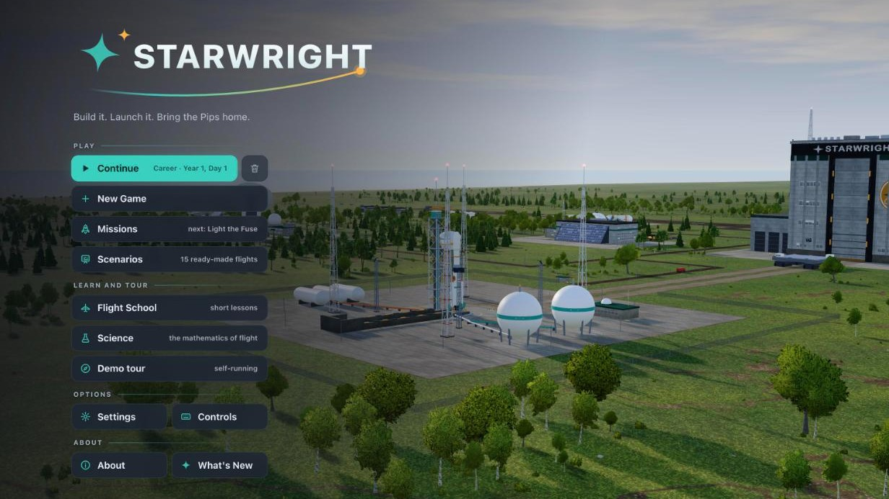
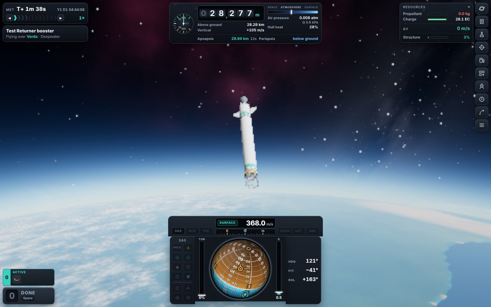

# Starwright player's manual

The reference for everything on the keyboard and every screen. New here? Start with the
[README](../README.md) for how to install the game and fly a first orbit, then come back.

Nothing needs installing to play: the game runs in your browser at
<https://jsmith0475.github.io/Starwright/>. Everything in this manual works the same there as
in a copy on your own machine, which is served at <http://localhost:8642/>.

Contents: [The front menu](#the-front-menu) ·
[Controls](#controls-mac-keyboard--logitech-mx-mouse) ·
[A first flight](#a-first-flight) ·
[Targeting, rendezvous and docking](#targeting-rendezvous-and-docking) ·
[Career, contracts and Flight School](#career-contracts-and-flight-school) ·
[Demo tour](#demo-tour)

## The front menu

The game opens on the front menu, in four groups. The mouse, Tab and the arrow keys all walk it,
and Return opens the entry that is lit.

- **Play.** *Continue* opens your saved game (the small bin beside it deletes that game, after
  asking). *New Game* starts a career, science or sandbox program. *Missions* opens Mission
  Control. *Scenarios* are ready-made flights that leave your own game alone.
- **Learn and tour.** *Flight School* has eight short lessons, *Science* is the reference on the
  mathematics the game flies by, and *Demo tour* lets the game fly itself.
- **Options.** *Settings* (among them, saving your game to a file and loading it back) and
  *Controls* (the keys and mouse actions).
- **About.** *About* tells the story behind the game and *What's New* lists what each release
  added.

The key names are for a Mac keyboard. On Windows and Linux, `Cmd` is `Ctrl`.

## Controls (Mac keyboard + Logitech MX mouse)

### Flight
| Keys | Action |
|---|---|
| W / S | Pitch down / up |
| A / D | Yaw left / right |
| Q / E | Roll left / right |
| Shift / Ctrl (or ↑ / ↓) | Throttle up / down |
| Z / X | Full throttle / cut throttle |
| Space | Launch / fire next stage |
| T | SAS (stability assist) on/off |
| R | RCS thrusters on/off |
| H / N, I / K, J / L | RCS translate forward/back, up/down, left/right |
| = | Cluster engines: burn the next set of engines (see *Shearwater* below) |
| G | Landing legs |
| U | Solar panels |
| M | Map view (click your orbit to plan a maneuver) |
| O | Missions: the next flight-program mission and your active contracts, with live progress |
| . / , | Time warp faster / slower |
| / | Stop time warp |
| V | Camera mode |
| ; | Stress overlay: a coloured band at every joint of the vessel (see *Structure* below) |
| C | Speed readout: surface / orbit / relative to the target (when one is set) |
| Y | Target the nearest vessel; press again for the next one |
| Shift+Y | Clear the target |
| [ / ] | Switch to a nearby vessel |
| \\ | Hop between a booster and its upper stage, at any distance (see *Boosters that fly on* below) |
| F5 or Shift+K | Quicksave |
| F9 or Shift+L | Quickload |
| Esc | Pause menu (revert, recover, return to Flight Center) |

### Mouse
| Input | Action |
|---|---|
| Scroll wheel | Zoom |
| Right-drag | Orbit the camera |
| Middle-drag | Pan (hangar) / offset view |
| Double-click | Centre / reset view |

### Flight screen buttons
The bar at the top right has **Map**, **Missions**, **Crew** (spacewalks), **Science** (run and transmit
experiments), **Target** (list of vessels and worlds), **Dock** (Latch Rings, docking assist,
undocking), **Fuel** (pump between tanks), **Ascent assist** and **Menu**. Dock and Fuel only appear
on vessels that can use them. Messages at the top of the screen queue up: two show at a time.

### Assembly Hangar
Click a part in the catalogue, then click on the rocket to attach it. `X` cycles symmetry
(Shift+X backwards), `Delete` removes the part under the mouse, `Esc` drops the held part,
`Cmd+Z` / `Shift+Cmd+Z` undo and redo. `L` shows the load on every joint; the Structure line at
the bottom names the joint that works hardest, and a click on it lists the five most loaded.

## A first flight

1. New Game → Sandbox (everything unlocked) or Career.
2. Flight Center → Launch Pad → pick the stock craft **Skylark II**.
3. SAS is already on (the `T` key toggles it). Press `Z` (full throttle), then `Space` (ignite).
4. At about 1 km start tipping east with `D`; aim for roughly 45° by 10 km and nearly flat by 40 km.
5. Press `Space` when the first stage runs dry. Open the map with `M` and keep burning until the
   apoapsis is about 80 km, then cut with `X`.
6. In the map, click your orbit near the apoapsis to add a maneuver node, drag the prograde handle
   until the periapsis is above 72 km, then burn at the node. You are in orbit.

## Structure: what holds a rocket together

A rocket is parts joined end to end and side to side, and every joint has a limit. The game works out, all
the time, how hard each joint is being pushed, pulled, bent and sheared. A joint that is asked for more
than it can take for longer than an instant breaks, and the rocket comes apart there.

**The Structure read-out** sits under the Δv line of the Resources panel (top right). It shows the load
on the most strained joint as a share of what that joint can take, with a small bar: **teal** below
50 %, **amber** from 50 %, **red** from 90 %. At 100 % the joint is at its limit. On the ground and at
high time warp there is nothing to measure, and it reads `--`. Hover over it (it opens by itself from
amber up) to see which joint it is and what is loading it, for example
"Stack Separator M / Taper Adapter L-M: bending, 82 %". The hull groans and the read-out flashes amber
when a joint passes 75 %.

**The stress overlay** (the `;` key, or a click on the read-out) puts a band around every joint of the
vessel, in the same three colours, so you can see where the load is. Grey bands mean "no reading".

What breaks a rocket:

- **Hard turns in thick air.** Flying sideways into the airstream at high speed bends the whole stack.
  The worst moment is around maximum dynamic pressure (the "Q" figure beside the altimeter, highest
  some way into the climb). Letting go of SAS and pulling hard there can snap a rocket in two.
- **Thin joints under heavy loads.** A joint is as strong as the smaller of the two parts it joins. A
  heavy upper stage on a narrow adapter or a small separator is a weak neck.
- **Long thin stacks.** The longer and thinner the rocket, the more it bends for the same sideways push.
- Separators, Latch Rings and side mounts are weaker than a plain tank-to-tank joint.

What helps:

- **Steer gently through the dense air.** Tip over early and a little at a time, then follow the
  prograde marker until the air thins out. Throttling back around maximum Q lowers the loads too.
- **Wider parts** at the joints that carry the most, and **shorter stacks**: put fuel in side boosters
  instead of making the core taller.
- **Brace Struts.** A Brace Strut whose tip reaches another part shares the load of the joints between
  the two. Run them from the core to the side boosters.
- The Assembly Hangar checks the design for the usual load cases before you fly.

**Parts the air can tear off.** Some parts are rated for how much air may press on them, the way every
part has a temperature limit. The part card in the Assembly Hangar shows it as "Air limit".

- **Antennas, dishes, nose cones, fairings and the clamps that hold side boosters** are rated for air
  blowing *across* them. Nose first they feel nothing, however fast you go. Sideways at high Q they go:
  a rocket that flips around maximum Q loses its side boosters first, then its antennas, and the loose
  boosters lose their nose cones as they tumble away.
- **Folding solar panels** are rated for a few kPa of air from any direction while they are open. Open
  them in space. Stowed, they are safe.
- **Fins and wings** have no rating: they are held on by a thin root and break off when the lift on them
  bends it too far, which takes a large fin face on to fast, thick air.

The message says what went and why, for example "The Whip Antenna was torn off by the airflow: 18 kPa
across it, rated for 12 kPa". The Structure read-out shows the air figure when it is the highest one on
the ship. Pieces fly on as debris; the game keeps at most 24 loose pieces at a time.

If you would rather not lose rockets this way, switch **Structural failures** off in Settings (Esc →
Settings in flight). The loads are still measured and shown; nothing breaks and nothing is torn off.

## Landing on legs

Press G to let the legs down before you land. Each leg is a spring and a damper with a fixed
amount of travel, and how fast you touch down decides what happens:

| Touchdown speed | Lander Strut (32 cm of travel) |
| --- | --- |
| up to about 4 m/s | A clean landing. |
| about 5 to 6 m/s | The legs run out of travel. A hard jolt and a warning, nothing breaks. |
| about 7 m/s and up | The legs collapse. |

The Stilt Heavy Leg has 55 cm of travel and takes 2 to 3 m/s more; the Sprig has 18 cm and less
margin. The Heron Folding Leg has 40 cm and by far the widest stance. Land level and slow across the ground: a lander leaning past the line of its feet, or
arriving sideways, goes over. A wide stance and a low centre of mass stand steeper.

Once you are standing on the ground with the throttle closed, the attitude hold (T) lets go so
the craft can settle onto all its feet. Your own stick input still works. The full description
of the model is in [LANDING_LEGS.md](LANDING_LEGS.md).

## The landing autopilot

On a world with no air, Guidance offers **Land here**. It brakes out of orbit and sets the lander
down on its engine, and it looks at the ground before it does:

- From orbit it may say "the ground ahead is too steep to stand on" and stay in orbit under time
  warp until there is better ground below. It waits one orbit at most.
- On the way down it keeps clear of hills, and pulls up if one rises in front of it.
- At the hover it tells you what is under you, flies across to the nearest level spot, and comes
  down there.
- If nothing in reach is fit to stand on it warns you and goes to the least steep ground it found.
  Take that warning seriously: take over, or expect to end up on your side.

How steep is too steep depends on the lander. A tall lander on narrow legs is held to about
5 degrees, a squat one to 6. Any steering key gives you back control. The whole story, with what was
checked, is in [LANDING_SITES.md](LANDING_SITES.md).

## Boosters that fly on

A first stage with a guidance ring on it (any probe core, or a Beacon or Keystone ring, placed
below the separator) is not thrown away when you stage. It becomes a **booster**: a ship of its
own that keeps flying under full physics however far it gets from the upper stage.

A stack separator fires at both ends, so the booster comes home with a clean top: the ring
that joined the stages, and the lattice round the upper engine, are thrown clear half a second later as a third piece.

- Press **\\** to hop to the booster, and **\\** again to hop back. **[** and **]** reach it too.
- If the ascent assist is flying the upper stage, it carries on to orbit while you fly the
  booster, and tells you when it gets there.
- Fast time warp waits while the other vessel is still in flight. The message names it.
- A stage without a guidance ring is debris, as before.

### Bringing it back

Give that first stage **landing legs** near the bottom and **grid fins** (Lattice Vanes) near the
top as well, and it comes home by itself. The **Heron Folding Leg** is the one made for a
booster: it lies flat against the tank for the whole flight and swings out 60 m above the
ground, a few seconds before touchdown.

1. Launch with the ascent assist. It stages early, when the booster has just enough propellant
   left to return, and tells you so.
2. The booster flips, burns back toward the pad, steers on its fins and lands on its legs at the
   **Return Pad**, the marked concrete pad 600 m north of the launch pad. Every step is called
   out on screen.
3. Press **\\** to watch it. Touch the controls and you are flying it. The assist takes the upper
   stage to orbit either way.

Flying by hand instead? When you are in the air over Verda, Guidance has **Fly back and land**.
Without legs a stage is never flown back, and without grid fins it misses by kilometres. A stage
dropped too late and too fast cannot reach the pad: the program says so and lands where it can.

**The barge.** *Patient Tide* is a steel deck anchored 40 km east of the pad, under your launch
path. To land there instead, hop to the booster, open Guidance and choose **Land on the barge**.
It costs less propellant than flying all the way back. The deck is 80 by 50 m and its edge is
real: a booster with its feet over the side goes into the sea. The map marks both landing sites
when you zoom in on Verda.

Landing a booster pays nothing yet. The full description
is in [BOOSTERS.md](BOOSTERS.md).

## Shearwater: methane, oxygen and 39 engines

The stock rocket **Shearwater** is modelled on SpaceX's Starship at five-eighths size: a booster
with 33 Peregrine engines and a ship with 6. Three things about it are new.

- **Two gauges.** It burns methane and liquid oxygen, 3.6 kg of oxygen to each kilogram of
  methane, and the resource panel shows the two separately. If either runs out the engines
  stop.
- **Engine sets.** Press **=** and the lit cluster moves to its next set: on the booster all 33,
  the inner 13, then the centre 3; on the ship all 6, the three sea-level engines, then the three
  vacuum engines. Fewer engines burn less and push less. The ship's vacuum three alone are its
  most efficient setting once it is out of the air.
- **Hot staging.** Press Space at booster burn-out and the ship lights its engines first. The
  ring between the stages lets go 0.8 s later and stays on the booster.

- **The Catch Tower.** A stack with catch pins and no legs launches from the tower's mount,
  500 m north-west of the launch pad, not from the pad. Launch with the ascent assist and the
  booster flies itself back and is caught by the tower's arms about five minutes after
  lift-off, while the ship goes on to orbit. Press **\\** to watch it. To fly the catch yourself,
  bring the booster's base down to 3 m above the mount, within 2.5 m of its axis, slower than
  5 m/s down and 2 m/s sideways, and upright to within 8°. Miss any of those and the game says
  which.

- **Refuelling in orbit.** The ship carries a **Flank Port** on its side. Meet a depot that has
  one (the scenario **Topping Up** puts you 150 m from *Deepwell*), open the Dock panel and
  engage the docking assist: the two dock side by side with their hulls parallel. Then open the
  Fuel panel and press **Fill Shearwater**. Oxygen and methane cross at 300 kg a second while
  the thrusters push gently along the stack; liquid in free fall floats in its tank, and the
  push holds it on the outlet. Stop the push and the flow stops.

Launch it with the ascent assist and it reaches an 80 km orbit with about 42 % of the ship's
propellant left. That is not enough to go to Pell and come back, which is what the depot is
for. The ship's return is not built yet: [SHEARWATER.md](SHEARWATER.md) has the numbers and
the plan. In career mode it needs the launch pad at its top level (772 t).

## Targeting, rendezvous and docking

Two stock craft are made for this: **Latch Target** (an uncrewed station core) and **Latch
Chaser** (a crewed ship with RCS thrusters). Both carry a **Latch Ring S** on the nose. Launch the
target into orbit first, return to the Flight Center (the flight is kept), then launch the chaser.

**Pick a target.** Press `Y` for the nearest vessel, open **Target** for a list of vessels and
worlds, or click a vessel or world in the map and choose *Set as target*. `Shift+Y` or the `×` on
the read-out clears it. A target that is destroyed or burns up is dropped for you.

**Read-outs.** With a target set, a card above the altitude panel shows its name, the distance,
the relative speed (`▸◂` closing, `◂▸` opening) and the closest approach on your present orbit.
The ball gains two orchid markers: a bracketed dot for the target and three spokes for the
direction directly away from it. Press `C` until the speed chip says **Target** to read your speed
relative to the target; the prograde and retrograde markers then show your drift relative to it.

**SAS target modes.** Four small buttons under the SAS / RCS lights: point at the target, point
away from it, point along your drift relative to it, and point against that drift. The last one
is the useful one: hold it and burn until the relative speed reads zero and you are parked beside
the target.

**Flying an entry with lift.** A capsule falls ballistically unless you ask it to do better.
On the way down an **Entry** box opens under the resources. **TRIM** shifts ballast inside the
capsule so it rests at 18 degrees to the air and lifts. **BANK** switches on Bank hold: the
capsule keeps that attitude and `Q` / `E` turn the lift, 20 degrees a second. Bank 0° is lift
up (a gentler, longer entry), 180° is lift down (shorter and harder), and a bank to one side
moves the landing point that way. The box shows the bank, the lift over drag, the heat flux
and the peak g and heating still ahead, and the map draws the path through the air to the
cross where you come down. Coming back from Pell, do not hold the lift up on a shallow
entry: the box will warn that the path skips back out to space. Details:
[ENTRY.md](ENTRY.md).

**Getting close.** In the map, plan a burn that brings the *closest approach* marker down to a
few hundred metres (lower orbits go round faster, so a lower orbit catches up and a higher one
falls back). At the closest approach, point against the drift and burn to stop. Flight School has
a lesson on it: *Rendezvous basics*.

**Docking.** Rings of the same size (S with S, M with M) latch by themselves when they touch nose
to nose, roughly aligned, slower than 1.5 m/s. By hand: turn on RCS (`R`), point at the target,
and close the last metres with `H` / `N` (forward / back) and `I` `K` `J` `L` (slide). Or open
**Dock** and press **Engage** on *Docking assist* once you are within 1.5 km and drifting slowly
relative to the target: the guidance computer lines up the rings and flies the approach on
monopropellant. Any steering or translation key hands control back to you.

Docked vessels are one vessel: one set of controls, shared stages, and engines can draw from tanks
on both sides. **Dock → Undock** releases a module; the two drift apart at 0.3 m/s and each keeps
its own name and crew.

### Fuel transfer

Open **Fuel** on any vessel with at least two tanks that hold the same thing (it does not have to
be docked). Choose *Propellant*, *Monoprop* or *Charge*, pick the tank to take **From** and the
tank to pump **Into** (each is labelled with the vessel it arrived with), then:

- type an amount and press **Transfer** (leave it empty for as much as fits),
- **All** pumps until the source is empty or the destination is full,
- **Balance** brings both tanks to the same fill level,
- `⇅` swaps the two tanks.

Solid fuel and heat-shield ablator cannot be pumped.

## Career, contracts and Flight School

- **Game modes.** *Career* has funds, science and reputation; *Science* drops the budget;
  *Sandbox* unlocks everything.
- **Science and research.** Run experiments from the Science button in flight. Recover the vessel
  to bank results in full, or transmit them with an antenna for half. Spend science in the
  Research Lab to unlock tech nodes and their parts. If a stock craft in the launch dialog needs
  parts you do not have yet, the dialog names the tech nodes to research.
- **Interface size.** Settings has an *Interface size* row (Auto, or 80 % to 175 %). Auto leaves the interface as it
  is up to a 1600 x 900 window and enlarges it on bigger ones (160 % at 2560 x 1440), so text stays readable on a
  large display. The 3D picture is not affected.
- **Missions.** *Missions* on the title menu opens Mission Control (or explains missions and starts a career if
  you have none). Two kinds of mission live there:
  - **The flight program**: 71 missions in a fixed order, so there is always a next goal: first launch, 10 km,
    space, an orbit of Verda, a crewed return, a spacewalk, then Pell and Ost (fly by, orbit, land, come back) and
    after them every other world of the Helion system. Nothing to sign and no deadline: fly it and it counts. It is
    tracked in every game mode; a career is paid funds, science and reputation for each one.
  - **Contracts** (career only), described next.
  In flight, the **Missions** button (or `O`) lists the next program mission and your active contracts, each
  objective with a tick and a live read-out (altitude against the target, the orbit and what is wrong with it,
  seconds held, time left on the deadline).
- **Contracts (Mission Board).** The board keeps three to five offers, growing with reputation,
  and you can hold three to five at once. Accepting pays an advance (a quarter of the fee);
  finishing every objective pays the rest plus science and reputation; missing the deadline or
  cancelling costs funds and reputation. Jobs include reaching an altitude with a Pip aboard,
  test-firing a part inside an altitude and speed window, delivering an experiment result from a
  named place, planting a flag, holding a given orbit, deploying a relay satellite, flying by or
  landing on another world, tourist round trips, and recovering a well-travelled vessel. Offers
  only ask for things your unlocked parts can do. In flight, a toast tells you when an objective
  or a contract is completed (or failed).
- **Crew.** Pips gain experience and stars from recovered flights; starred pilots, engineers and
  scientists improve recovery payouts and science.
- **Flight School** (its own building at the Flight Center, also on the title menu): eight short
  illustrated lessons — *Your first hop*, *How orbits work*, *Reaching orbit, step by step*,
  *Maneuver nodes*, *Getting to Pell*, *Landing on an airless moon*, *Re-entry and parachutes* and
  *Rendezvous basics* — most with a **Try it** button that puts the right stock craft on the pad,
  plus a controls reference, a delta-v card for the whole Helion system and a glossary.
- **Saves.** The game saves when you leave a screen. In flight, `F5` quicksaves and `F9` loads.
  If a flight in progress can no longer be loaded, the message that says so has a **Discard it**
  button; new launches keep working either way.

## Demo tour

Starwright can show itself off. **Demo tour** on the title screen (also in the Flight Center menu)
starts a self-running, captioned tour of the real game: the space centre from day to night, a
rocket built part by part, launch and staging, the gravity turn to orbit, a maneuver node and the
transfer to the moon Pell, a landing with EVA, flag and science, re-entry and splashdown, a
spaceplane take-off, a rover on Rusk, a docking, the tracking station, the nineteen-body Helion
system, and research, contracts and crew. It takes about six minutes, runs on a throw-away
program and never touches your save.

- Start it directly with <https://jsmith0475.github.io/Starwright/?demo=1> in the browser, or
  <http://localhost:8642/?demo=1> on your own copy; add `&clean=1` to hide the control strip
  and the mouse cursor for a recording, or `&chapter=<id>` to start at one chapter.
- `Space` pauses, `←` `→` change chapter, `Esc` leaves.
- [DEMO.md](DEMO.md) has the chapter list and step-by-step instructions for recording
  the tour as a video on a Mac.
